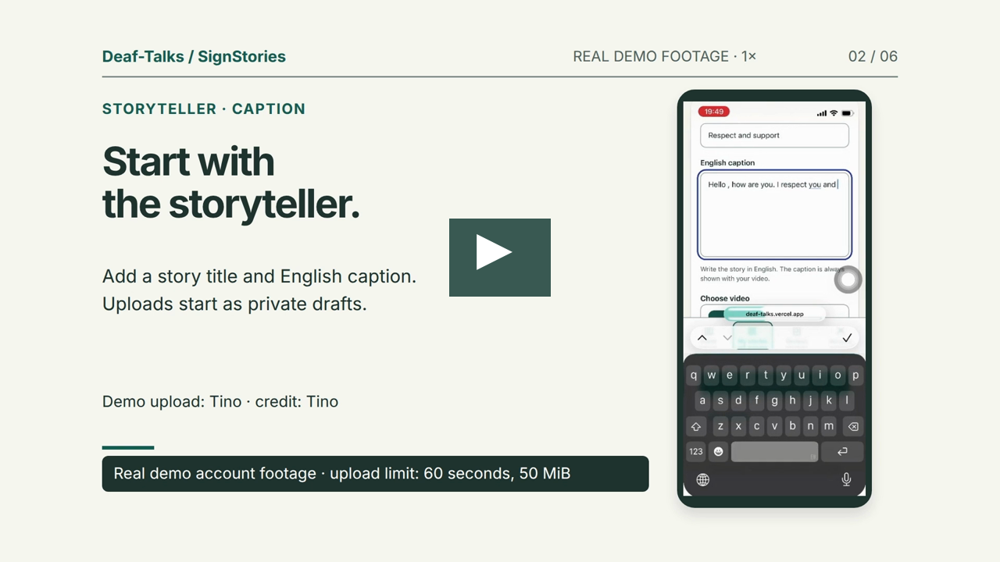
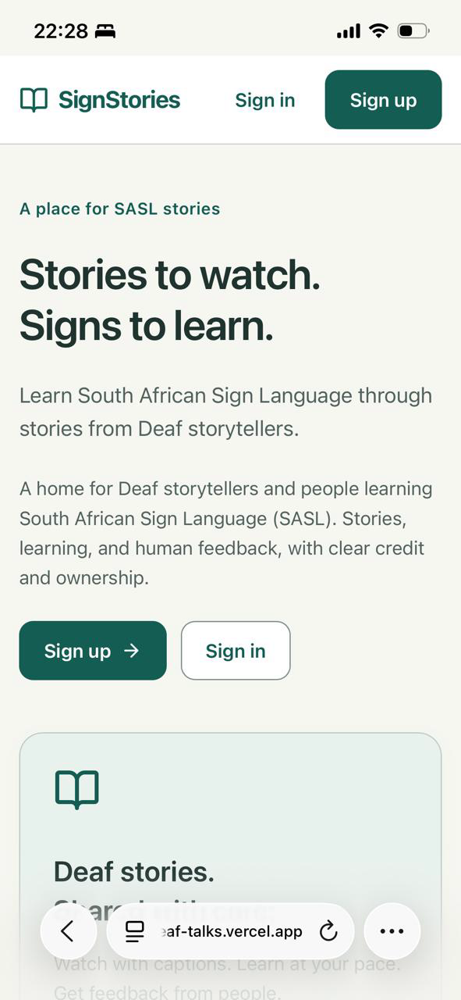
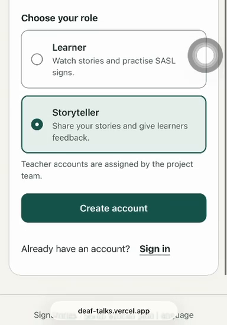
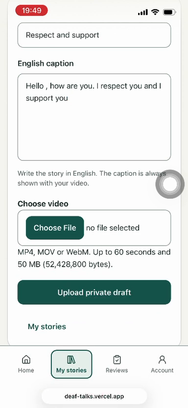
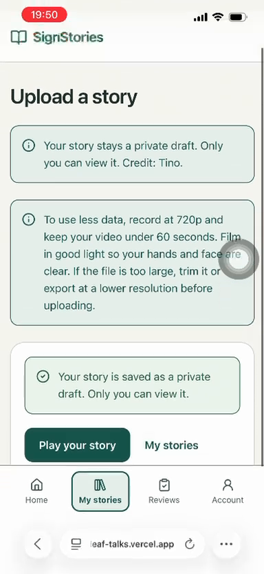
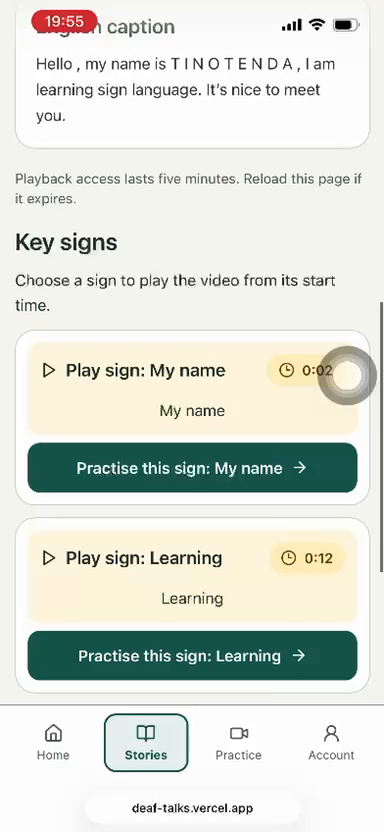
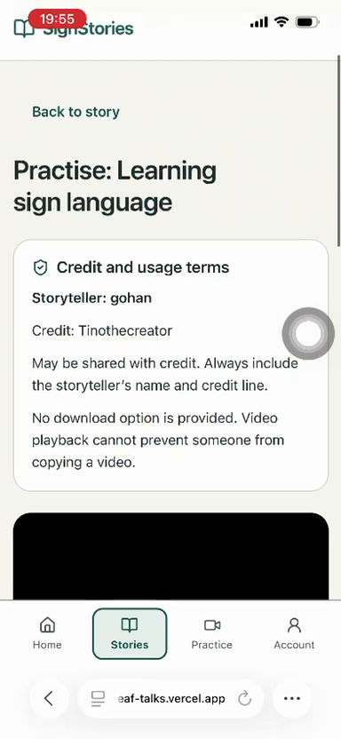
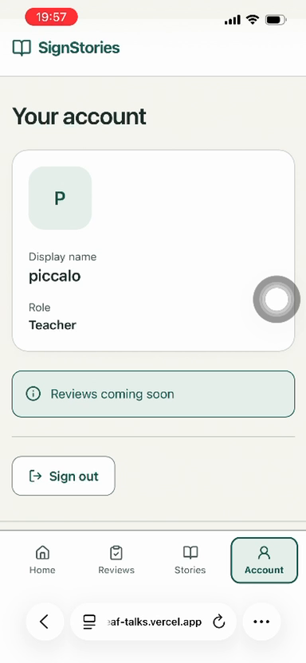
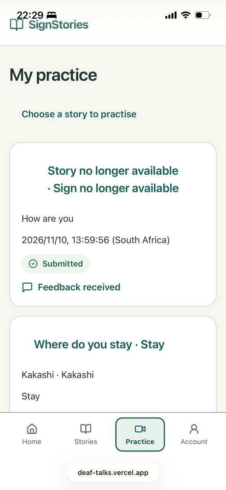
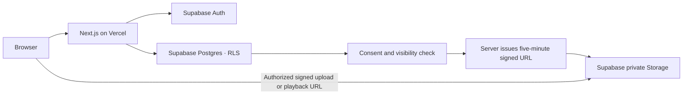

# Deaf-Talks · SignStories

Deaf storytellers share South African Sign Language (SASL) stories; learners learn signs through stories, with human feedback, consent and clear credit.

[Live app](https://deaf-talks.vercel.app) · [Demo video](https://youtu.be/xIUJKuEgD5o) · [Walkthrough](brag-output/deaf-talks-demo.mp4) · [Repo](https://github.com/tinothecreator/Deaf-Talks)

## Demo video

[](https://youtu.be/xIUJKuEgD5o)

[Watch the short demo on YouTube](https://youtu.be/xIUJKuEgD5o). [Longer walkthrough: 4:55, MP4, about 17 MB](brag-output/deaf-talks-demo.mp4).

## Try it now

Open **[deaf-talks.vercel.app](https://deaf-talks.vercel.app)**. Email confirmation is on: use a real email and confirm it before signing in, or use the demo accounts below.

**Demo accounts** (already confirmed, so no email needed; sign in at [deaf-talks.vercel.app](https://deaf-talks.vercel.app)):

| Role | Email | Password |
| --- | --- | --- |
| Learner | `learner@demo.com` | `learn123` |
| Storyteller | `storyteller@demo.com` | `story123` |
| Teacher | `person@example.com` | `greenbeast` |

These are shared, throwaway accounts for judging only. Please don't upload anything personal.

| Role | How to explore |
| --- | --- |
| Learner | Sign up as Learner → Stories → open a story → read captions and credit → tap a sign to jump to its timestamp. My practice holds submitted attempts and feedback. |
| Storyteller | Sign up as Storyteller → Upload a story → add your own or permitted video and English caption → save a private draft → edit signs, consent, usage and credit → publish or withdraw. |
| Teacher | Assigned manually by an admin. Teachers can browse stories and use Reviews (`/reviews`) to watch submitted practice and leave written feedback. The Account page still has an outdated “Reviews coming soon” notice. |

## The problem and the idea

SASL learners need more learning content led by Deaf signers. Credit, consent and permission to reuse a story are often unclear. SignStories gives storytellers control over publication and usage, while learners explore captioned stories and timestamped signs. Feedback comes from people; AI never judges signing.

## Screenshots

Phone views from the supplied demo assets, shown small for scanning. All selected images are UI-only; [capture notes and coverage gaps](docs/JUDGES-NOTES.md#screenshot-provenance) explain the selection.

| Landing | Storyteller sign-up |
| --- | --- |
|  |  |
| Private upload and caption | Draft saved with credit |
|  |  |
| Watching: caption and tappable signs | Credit and usage on the practice page |
|  |  |
| Teacher account | Learner practice list |
|  |  |

## What's built

- Role-based sign-up, email confirmation and protected accounts; teachers are assigned by an admin.
- Private story uploads with progress: MP4, WebM or MOV; up to 60 seconds and 50 MiB (52,428,800 bytes).
- Timestamped sign tagging; 3–5 signs required to publish. Learners tap signs to seek playback.
- Consent, permitted usage and credit controls, with owner-only change history; publish and instant withdrawal from discovery and new playback access.
- Signed-in story browsing with visible English captions, storyteller name and credit. Five-minute playback links, private Storage and RLS-enforced consent. No download action.
- Also implemented after Milestone 5: learner practice recording/upload, written teacher/storyteller feedback, and OpenAI text-only caption translation drafts for isiZulu and Afrikaans, with storyteller approval before learner display.

Implementation is present in this checkout; hosted migrations, account flows and end-to-end behavior still need verification against the live project. Existing playback links can remain usable for up to five minutes after withdrawal.

## Milestones summary

| Milestone | What shipped | Key safeguards |
| --- | --- | --- |
| 1 · Foundation | Next.js, Supabase clients, environment template and app shell. | Server-only secrets; private buckets and RLS schema. |
| 2 · Accounts | Email/password sign-up, confirmation, sign-in and three roles. | No self-service Teacher role; database role lock. |
| 3 · Upload | Private draft upload, progress, owner list and playback. | Owner-bound paths, size checks, five-minute signed URLs; name and credit shown. |
| 4 · Ownership | Sign tags, consent/usage/credit editor, publish and withdraw. | Atomic publication validation, visibility policies and owner-only consent history. |
| 5 · Watching | Stories list, captions, credit/terms and tappable signs. | RLS read before signing; hidden stories receive no new playback link. |

[Full milestone notes, Supabase setup and manual test checklists](docs/MILESTONES.md) preserve the original development record. They describe each milestone at its time, including features subsequently added.

**What's next — not built yet:** AI practice prompts and timed subtitles. Practice recording, teacher feedback and AI-assisted caption **translation** via the OpenAI API already have implementations; they are not future-only features. Automatic captioning from video is not implemented. No sign-language recognition, generation, grading or translation from video is planned.

## Tech stack and architecture

| Layer | Technology |
| --- | --- |
| UI and server | Next.js App Router, strict TypeScript, Tailwind CSS, Zod |
| Identity and data | Supabase Auth, Postgres with RLS, private Storage |
| Hosting | Vercel |
| Text-only AI | OpenAI API in server code; drafts require storyteller approval |
| Development | Built with Codex |



Story reads use the user's session and RLS. Only after a visible story is read does server-only signing issue playback access; keys never go to the browser.

## Run locally

Node **22+** and a configured Supabase project are required.

```sh
npm ci
cp .env.example .env.local
# Fill in .env.local using your own project configuration.
npm run dev
```

```sh
npm run lint
npm run build
node --test tests/*.test.mjs
```

Set the two public Supabase variables for auth; learner playback also needs the server-only service-role key. AI translation needs server-only `OPENAI_API_KEY` and `OPENAI_MODEL`. Never commit values.

Follow [Supabase setup and migration order](docs/MILESTONES.md#exact-sql-and-run-order); for the later practice, feedback and translation migrations, see [current setup notes](docs/JUDGES-NOTES.md#current-database-setup). Tests use doubles and do not replace hosted RLS or phone testing.

Project docs: [Spec](SPEC.md) · [Plan](PLAN.md) · [Agent rules](AGENTS.md) · [Milestones](docs/MILESTONES.md).

## Accessibility and ethics

Captions remain visible as text by default; timed subtitles are not built. The UI uses mobile-first layouts, labelled controls and visible keyboard focus, with no audio-only information. Stories start private; consent and credit are part of publication, and people judge signing. AI works only on caption text and its drafts need approval. There is no download action, but playback cannot fully prevent copying. Duration checks rely on browser-reported metadata, not independent server inspection.

## Hackathon and credits

Built for the **OpenAI x Andela hackathon**, 9–11 November 2026, with **Codex**. Team: **[ADD TEAM NAMES]**.

Walkthrough made with the **[/brag skill (latent-spaces/brag)](https://github.com/latent-spaces/brag)** and **[Hyperframes](https://hyperframes.heygen.com)**. Music: “Happy Beats / Business Moves Vol. 12” by **[Sascha Ende, ende.app](https://ende.app/en)**, **[CC BY 4.0](https://creativecommons.org/licenses/by/4.0/)**; excerpts repeated with fades. The walkthrough uses brag's bundled track.
